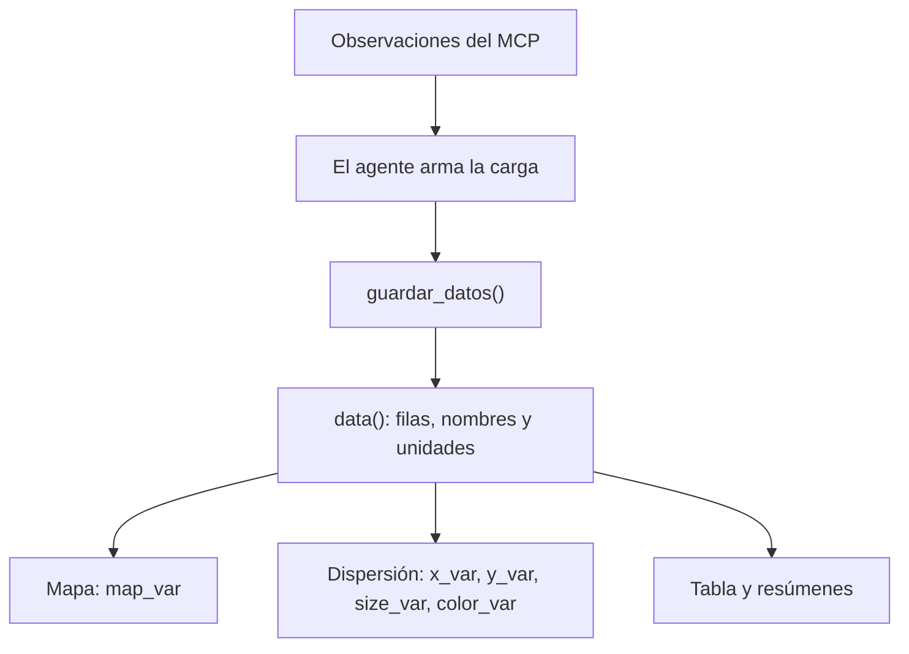

# App 09 · Conectar herramientas externas con MCP

Agrega herramientas remotas mediante MCP al chat que ya utiliza tools locales de Shiny.
El ejemplo usa **Luna** y el servidor comunitario de datos del Banco Mundial mantenido por **cyanheads**.
Empieza vacía: un solo `data()` alimenta el mapa, la dispersión, la tabla y los resúmenes.
Debajo de los indicadores, un `navset_card_tab()` separa **Visualización** (mapa y gráfico)
de **Datos** (tabla). Visualización contiene dos cards con título: **Mapa** y **Gráfico**.

La fuente estadística es el **Banco Mundial**. El
[servidor MCP comunitario](https://github.com/cyanheads/worldbank-mcp-server) no es un servidor oficial.
El endpoint `https://worldbank.caseyjhand.com/mcp` funciona sin token del Banco Mundial.
El modelo usa `OPENAI_API_KEY`. No hay SQL, DuckDB ni datos numéricos iniciales.

## Ejecutar

Desde la raíz, con el entorno restaurado mediante `renv::restore()`:

```r
readRenviron(".Renviron")
shiny::runApp("app-09")
```

## Una carga para toda la vista

`data()` guarda la carga completa:

- `datos`: filas con `pais` (ISO3), `anio`, `x_var`, `y_var`, `size_var`, `color_var` y `map_var`.
- `variables`: indicador, nombre y unidad de cada columna utilizada.

X e Y son los ejes, `size_var` es el tamaño y `color_var` colorea los puntos por un indicador numérico.
`map_var` determina el color del país de forma independiente.
Una variable puede ocupar varios papeles: por ejemplo, esperanza de vida en Y y en el mapa.
Los papeles no utilizados quedan como `NA`; los faltantes no se convierten en cero.



`guardar_datos()` recibe los objetos estructurados, arma los data frames con `bind_rows()` y reemplaza
la carga completa. No une con datos anteriores. El agente decide qué valores asignar a cada papel
usando exclusivamente las observaciones recibidas del MCP; cuatro decimales son suficientes.
La app no analiza una cadena JSON: ellmer convierte los argumentos a listas de R.
`ver_datos()` devuelve esa misma carga sin modificarla.

Cada nueva carga reemplaza la anterior. Para cambiar el color o mostrar solo algunos países,
el agente puede leer la carga y reenviar los datos disponibles, sin descargar otra vez.
No existen `region()`, `data_view()`, un catálogo de filtros ni un estado para series.
La app trabaja con un año o el último dato por país. Si se pide una serie temporal, explica ese alcance.

## Mapa y dispersión

Prueba primero:

> Colorea el mapa con el último dato disponible de esperanza de vida de cada país.

El MCP consulta `mrnev = 1`, el último valor no nulo de cada país, conservando su año real.
El mapa une las filas recibidas con Natural Earth mediante `inner_join()`: su capa de datos solo
contiene países con `map_var` disponible. No añade una capa de países sin datos.
La cartografía base sigue proporcionando contexto geográfico.
El tooltip muestra país, indicador, valor, unidad, año y fuente.

Después pide:

> Ahora genera un gráfico con PIB per cápita en X y la esperanza de vida ya descargada en Y.
> Usa escala logarítmica en X y conserva el mapa.

El agente lee la carga actual y consulta el PIB per cápita para el mismo año de cada fila.
Reutiliza la esperanza de vida en Y y en el mapa, sin volver a descargarla.
`configurar_grafico(log = "x")` cambia la escala visual de X sin transformar los datos guardados.
La dispersión usa una única capa de puntos de esa carga y `theme_minimal()`.
Sin datos, muestra un canvas con los ejes X e Y, sin puntos ni valores inventados.
El tamaño y el color son opcionales: si no se usan, los puntos tienen tamaño fijo y color uniforme.
El mapa y la tabla muestran los mismos países. Si faltan valores, se omiten de la visualización
que los necesita; la tabla conserva `NA`.

Las value boxes muestran países, período y cantidad de indicadores distintos de la carga.
Un indicador repetido en Y y mapa se cuenta una sola vez.
Finalmente pide:

> Ahora filtra solamente los países y territorios de América, reutilizando los datos cargados.

El agente lee `ver_datos()`, selecciona las filas de América y llama a `guardar_datos()`
sin descargar otra vez.
Mapa, gráfico, tabla y resúmenes se actualizan con esa selección; la escala de X se conserva.
El año y la cobertura dependen de las observaciones recibidas: compruébalos en la tabla.

Puedes pedir «Usa escala logarítmica en X» o «Colorea los puntos por esperanza de vida».
Para cambiar los ejes llama a `configurar_grafico(log)`, con `""`, `"x"`, `"y"` o `"xy"`.
El área de los puntos es proporcional al valor con `scale_size_area()` de ggplot2.
Puedes pedir «Usa tamaño logarítmico»: `configurar_grafico(tamano = "log10")` comprime su rango.
Usa `tamano = "area"` para volver al área proporcional. Los argumentos omitidos conservan su estado.
La configuración visual queda fuera de `data()`; no vuelve a guardar ni descargar observaciones.
Para cambiar la variable del color sí reutiliza la carga mediante `guardar_datos()`.
Las escalas solo cambian los ejes; la tabla conserva los valores y unidades originales.
En ejes logarítmicos se omiten los puntos con valores no positivos, conservando esas filas en la tabla.

Se evaluó tinyplot 0.7.0: permite estas representaciones, pero sus dos leyendas necesitan más ajustes
para mostrar nombres y unidades dinámicos. Se conserva ggplot2 para mantener ese código sencillo.
`thematic::thematic_shiny(font = "auto")` y ragg vinculan la tipografía con la interfaz de `_brand.yml`.

## Conexión MCP

`R/06_ellmer_mcp.R` muestra el registro de herramientas en una conversación de consola.
Se ejecuta desde la raíz con `source("R/06_ellmer_mcp.R", encoding = "UTF-8")`.
Incluye la selección de tres tools y el ajuste de esquema de App 09, sin cargar un script auxiliar.

`mcp.json` configura el endpoint con un timeout de 60 segundos.
`mcp-tools.R` prepara búsqueda, metadatos y observaciones:

- `worldbank_search_indicators`: encuentra el indicador.
- `worldbank_get_indicator`: confirma definición, fuente y unidad.
- `worldbank_get_data`: consulta `indicator_id`, `countries`, `date_range` o `mrnev`, y paginación.

Para un año, `date_range = "2023"`; para el último dato por país, `mrnev = 1`, sin `date_range`.
`countries = "all"` permite consultar todos los países; el agente omite agregados y valores `null`.
Se comprobó `per_page = 1000`; hay que revisar `totalPages`.
Cada fila de `resultado@value$data` contiene `countryIso3`, `countryName`, `date` y `value`.
Se conserva el ajuste de esquema necesario con ellmer 0.4.2; no añade validaciones a la carga local.

## Comparación y demo guardadas

`data/comparacion.json` y `.rds` conservan conversaciones independientes con el mismo `gpt-5-nano`
y prompt neutral, sin y con MCP: esperanza de vida de Colombia en 2023. Las slides leen ese JSON local.
La comparación es independiente de las tools locales del dashboard.

```r
readRenviron(".Renviron")
source("app-09/cache-comparison.R", chdir = TRUE, encoding = "UTF-8")
source("app-09/verify-comparison.R", chdir = TRUE, encoding = "UTF-8")
```

`data/demo.json` guarda la conversación real de la carga única: mapa, dispersión, otro año,
reutilización, alcance de series y reducción a Chile. El verificador contrasta las cifras del MCP
con la tabla, los puntos y los polígonos, sin conectarse a internet.

```r
source("app-09/verify-demo.R", chdir = TRUE, encoding = "UTF-8")
```

Para regenerar la demo real, valida primero un archivo temporal y conserva la caché hasta que pase:

```r
readRenviron(".Renviron")
source("app-09/cache-demo.R", chdir = TRUE, encoding = "UTF-8")
```

`renv.lock` conserva la revisión comprobada de `mcptools`.
Si Windows arranca con el locale inválido `C.UTF-8`, ejecuta
`Sys.setlocale("LC_CTYPE", ".UTF-8")` antes de conectar.
