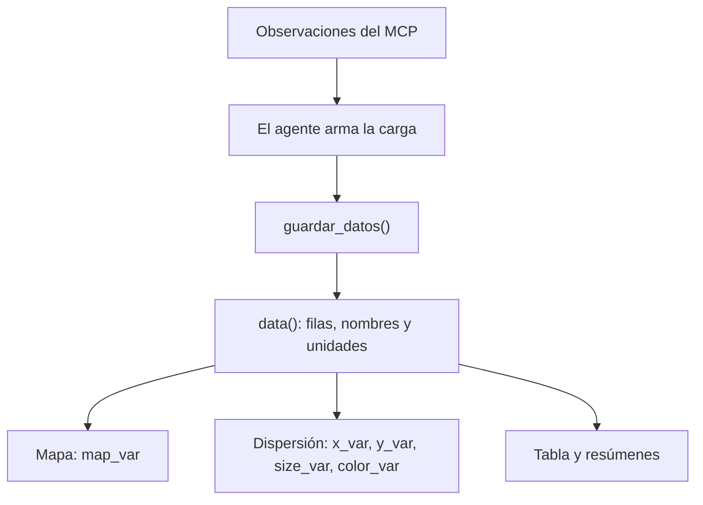

# App 09 · Conectar herramientas externas con MCP

Agrega herramientas remotas mediante MCP al chat que ya utiliza tools locales de Shiny.
El ejemplo usa **Luna** y el servidor comunitario de datos del FMI mantenido por **cyanheads**.
Empieza vacía: un solo `data()` alimenta el mapa, la dispersión, la tabla y los resúmenes.
Debajo de los indicadores, un `navset_card_tab()` separa **Visualización** (mapa y gráfico)
de **Datos** (tabla). Visualización contiene dos cards con título: **Mapa** y **Gráfico**.

La fuente estadística es **FMI · World Economic Outlook (WEO)**. El
[servidor MCP comunitario](https://github.com/cyanheads/imf-mcp-server) no es un servidor oficial.
El endpoint `https://imf.caseyjhand.com/mcp` no necesita un token propio.
El modelo usa `OPENAI_API_KEY`. No hay SQL, DuckDB ni datos numéricos iniciales.

## Ejecutar

Desde la raíz, con el entorno restaurado mediante `renv::restore()`:

```r
readRenviron(".Renviron")
shiny::runApp("app-09")
```

## Una carga para toda la vista

`data()` guarda la carga completa:

- `datos`: filas con `pais` (ISO3), `anio`, `x_var`, `y_var`, `size_var`, `color_var` y `map_var`.
- `variables`: indicador, nombre y unidad de cada columna utilizada.

X e Y son los ejes, `size_var` es el tamaño y `color_var` colorea los puntos por un indicador numérico.
`map_var` determina el color del país de forma independiente.
Una variable puede ocupar varios papeles: por ejemplo, inflación en Y y en el mapa.
Los papeles no utilizados quedan como `NA`; los faltantes no se convierten en cero.



`guardar_datos()` recibe los objetos estructurados, arma los data frames con `bind_rows()` y reemplaza
la carga completa. No une con datos anteriores. El agente decide qué valores asignar a cada papel
usando exclusivamente las observaciones recibidas del MCP; cuatro decimales son suficientes.
La app no analiza una cadena JSON: ellmer convierte los argumentos a listas de R.
`ver_datos()` devuelve esa misma carga sin modificarla.

Cada nueva carga reemplaza la anterior. Para cambiar el color o mostrar solo algunos países,
el agente puede leer la carga y reenviar los datos disponibles, sin descargar otra vez.
No existen `region()`, `data_view()`, un catálogo de filtros ni un estado para series.
La app compara países en un año común. Si se pide una serie temporal, explica ese alcance.

## Mapa y dispersión

Prueba primero:

> Colorea los países de América Latina según su inflación promedio anual en 2023.

El MCP consulta WEO para un año explícito; `PCPIPCH` representa la inflación promedio anual.
El mapa une las filas recibidas con Natural Earth mediante `inner_join()`: su capa de datos solo
contiene países con `map_var` disponible. No añade una capa de países sin datos.
La cartografía base sigue proporcionando contexto geográfico.
El tooltip muestra país, indicador, valor, unidad, año y fuente.

Después pide:

> Ahora agrega un gráfico con crecimiento real del PIB en X, inflación en Y y población como tamaño.
> Conserva el mapa.

El agente lee la carga actual y consulta crecimiento (`NGDP_RPCH`, %) y población (`LP`).
La población conserva el valor, la unidad y la escala de la edición consultada de WEO.
Reutiliza la inflación en Y y en el mapa. Los ejes son lineales: el crecimiento puede ser negativo.
La dispersión usa una única capa de puntos de esa carga y `theme_minimal()`.
Sin datos, muestra un canvas con los ejes X e Y, sin puntos ni valores inventados.
El tamaño y el color son opcionales: si no se usan, los puntos tienen tamaño fijo y color uniforme.
El mapa y la tabla muestran los mismos países. Si faltan valores, se omiten de la visualización
que los necesita; la tabla conserva `NA`.

Las value boxes muestran países, período y cantidad de indicadores distintos de la carga.
Un indicador repetido en Y y mapa se cuenta una sola vez.
Finalmente pide:

> Ahora consulta las mismas variables para 2020 y actualiza la vista.

El agente descarga las tres variables para 2020 y reemplaza la carga completa.
Mapa, gráfico, tabla y resúmenes se actualizan para comparar el panorama económico entre años.
La cobertura depende de las observaciones recibidas: comprueba países y unidades en la tabla.
Si pides filtrar países, `ver_datos()` permite reutilizar la carga sin descargar otra vez.

Puedes pedir «Colorea los puntos por crecimiento» o cambiar las escalas de variables positivas.
Para cambiar los ejes llama a `configurar_grafico(log)`, con `""`, `"x"`, `"y"` o `"xy"`.
El área de los puntos es proporcional al valor con `scale_size_area()` de ggplot2.
Puedes pedir «Usa tamaño logarítmico»: `configurar_grafico(tamano = "log10")` comprime su rango.
Usa `tamano = "area"` para volver al área proporcional. Los argumentos omitidos conservan su estado.
La configuración visual queda fuera de `data()`; no vuelve a guardar ni descargar observaciones.
Para cambiar la variable del color sí reutiliza la carga mediante `guardar_datos()`.
Las escalas solo cambian los ejes; la tabla conserva los valores y unidades originales.
En ejes logarítmicos se omiten los puntos con valores no positivos, conservando esas filas en la tabla.

Se evaluó tinyplot 0.7.0: permite estas representaciones, pero sus dos leyendas necesitan más ajustes
para mostrar nombres y unidades dinámicos. Se conserva ggplot2 para mantener ese código sencillo.
`thematic::thematic_shiny(font = "auto")` y ragg vinculan la tipografía con la interfaz de `_brand.yml`.

## Conexión MCP

`R/06_ellmer_mcp.R` muestra el patrón básico con el MCP del FMI en una consola interactiva.
Se ejecuta desde la raíz con `source("R/06_ellmer_mcp.R", encoding = "UTF-8")`.
Registra todas sus herramientas sin filtros ni ajustes, igual que App 09 v2.

`mcp.json` configura el FMI con un timeout de 60 segundos.
La app registra todas sus herramientas directamente con `set_tools(mcp_tools("mcp.json"))`:

- `imf_list_databases`: encuentra la base, por ejemplo WEO.
- `imf_get_database`: consulta dimensiones y códigos de indicadores y países.
- `imf_query_dataset`: recupera observaciones para países, indicadores y períodos.
- `imf_dataframe_describe` e `imf_dataframe_query`: consultan resultados grandes guardados en DataCanvas.

En WEO, `key_format` indica `COUNTRY.INDICATOR.FREQUENCY`; una clave sería `CHL.PCPIPCH.A`.
Para un año, `start_period` y `end_period` coinciden. Las observaciones incluyen `series_key`,
`time_period` y `value`; los metadatos permiten interpretar unidades y estado de la serie.
WEO incluye estimaciones y proyecciones: el agente debe distinguirlas cuando corresponda.

## Banco Mundial conservado

`mcp-worldbank.json` conserva su endpoint. `mcp-tools.R` es el ajuste específico del **MCP del Banco Mundial**:
selecciona tres tools y acota los argumentos de consulta. La app del FMI no lo necesita ni lo carga.
Se conserva para revisar ese ajuste y regenerar la comparación anterior.

## Comparación y demo guardadas

`data/comparacion.json` y `.rds` conservan conversaciones independientes con el mismo `gpt-5-nano`
y prompt neutral, sin y con MCP: esperanza de vida de Colombia en 2023. Las slides leen ese JSON local.
La comparación es independiente de las tools locales del dashboard.
Es una ejecución del Banco Mundial, no una ejecución del nuevo ejemplo del FMI.

```r
readRenviron(".Renviron")
source("app-09/cache-comparison.R", chdir = TRUE, encoding = "UTF-8")
source("app-09/verify-comparison.R", chdir = TRUE, encoding = "UTF-8")
```

`data/demo-fmi.json` guarda la demo del FMI: inflación en 2023, dispersión con crecimiento y población,
y cambio a 2020. El verificador contrasta cifras del MCP con tabla, puntos y polígonos sin internet.
`data/demo.json` conserva la demo histórica del Banco Mundial; no se presenta como una consulta del FMI.

```r
source("app-09/verify-demo.R", chdir = TRUE, encoding = "UTF-8")
```

Para regenerar la demo real, valida primero un archivo temporal y conserva la caché hasta que pase:

```r
readRenviron(".Renviron")
source("app-09/cache-demo.R", chdir = TRUE, encoding = "UTF-8")
```

`renv.lock` conserva la revisión comprobada de `mcptools`.
Si Windows arranca con el locale inválido `C.UTF-8`, ejecuta
`Sys.setlocale("LC_CTYPE", ".UTF-8")` antes de conectar.
