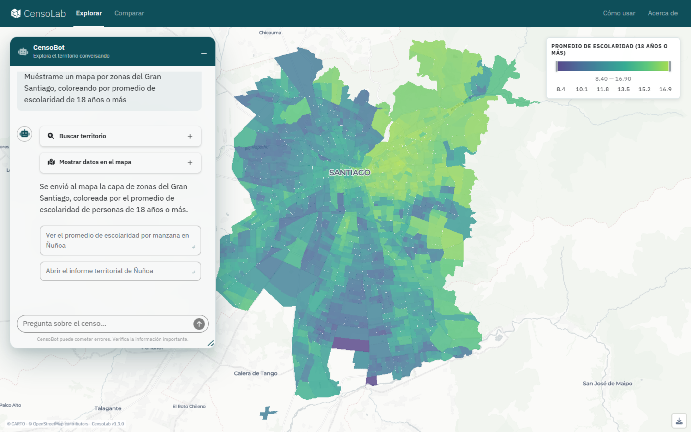
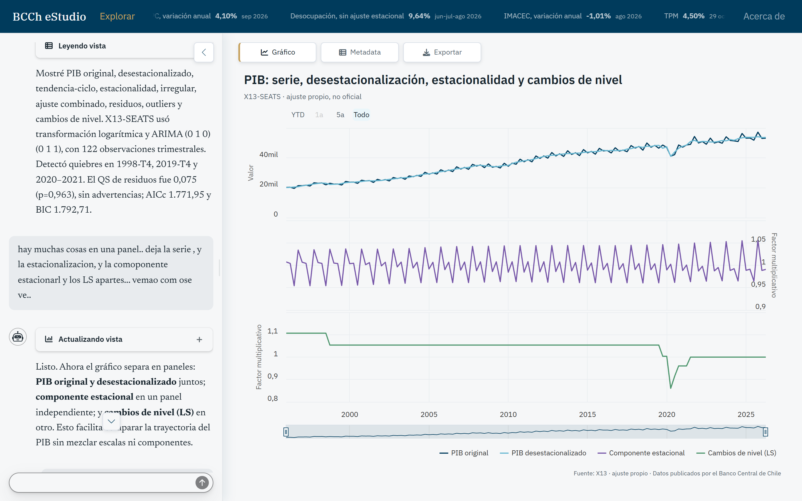

```{r}
#| label: setup-code-block
#| include: false
# Evita que R imprima tildes como <U+...> al renderizar en Windows con locale C.
if (.Platform$OS.type == "windows") Sys.setlocale("LC_CTYPE", ".UTF-8")

# Inserta un archivo R como Markdown. Las descripciones nombradas agregan
# anotaciones y pasos de resaltado para los rangos de líneas indicados.
code_block <- function(path, descriptions = NULL, single_copy = TRUE) {
  # Cuidados de mantenimiento (detalle en README.md):
  # - path es relativo a este QMD; los rangos corresponden al archivo original completo.
  # - Conservar .workshop-code en ambos modos: aplica fuente de 19 px a los archivos completos.
  #   Todo el código comparte el límite general de altura y los márgenes de assets/theme.scss.
  # - El CSS también define el ancho, fondo y z-index del tooltip para mantenerlo legible.
  # - assets/code-highlights.js resalta un único bloque; single_copy = FALSE recupera las copias de Reveal.
  # - assets/code-tooltips.js mantiene el tooltip encima del marcador y fuera del contenedor con scroll.
  #   Ambos scripts se cargan desde assets/cover.html; z-index por sí solo no corrige el recorte.
  # - Al cambiar fuente, altura o Quarto/codefrag, revisar App 02 (pasos 3 y 4), avance,
  #   retroceso y ventanas de distinto tamaño; comprobar líneas largas y el alto de App 01.
  path <- file.path(dirname(knitr::current_input(dir = TRUE)), path)
  code <- readLines(path, encoding = "UTF-8", warn = FALSE)

  if (is.null(descriptions)) {
    return(cat("```{.r .workshop-code}", paste(code, collapse = "\n"), "```", sep = "\n"))
  }

  ranges <- names(descriptions)
  first_lines <- as.integer(sub("-.*", "", ranges))
  code[first_lines] <- paste(code[first_lines], sprintf("# <%d>", seq_along(descriptions)))
  attribute <- if (single_copy) "data-workshop-highlights" else "code-line-numbers"
  steps <- paste(ranges, collapse = "|")
  if (!single_copy) steps <- paste0("|", steps)
  fence <- sprintf('```{.r .workshop-code %s="%s"}', attribute, steps)
  notes <- sprintf("%d. **%d.** %s", seq_along(descriptions), seq_along(descriptions), descriptions)
  cat(fence, paste(code, collapse = "\n"), "```", "", notes, sep = "\n")
}
```

# Antes de empezar {.section-slide}

Motivación, recorrido del taller y preparación del entorno.

## Motivación {.content-centered}

Una pregunta en lenguaje natural puede activar consultas, cálculos y cambios en la vista.

El agente interpreta el pedido y facilita la exploración de los datos de la aplicación.

::: {.columns}
::: {.column width="50%"}
### [CensoLab](https://censolab.cl/)

[{fig-alt="CensoLab: mapa de escolaridad del Gran Santiago."}][censolab]
:::
::: {.column width="50%"}
### [BCCh Studio](https://jbkunst-bcch-studio.share.connect.posit.cloud/)

[{fig-alt="BCCh Studio: PIB y estacionalidad."}][bcch-studio]
:::
:::

::: {.notes}
Presentación y capturas: https://kpstudio.io/#proyectos.
CensoLab conecta preguntas sobre el Censo 2024 con cálculos, mapas, tipologías e informes territoriales.
Está desarrollado principalmente en R con Shiny: https://censolab.cl/acerca-de/.
BCCh Studio permite buscar y comparar series del Banco Central de Chile, aplicar métodos estadísticos,
visualizar y elaborar proyecciones con trazabilidad de los datos y resultados.
Las capturas muestran un pedido de mapa de escolaridad y otro de reorganización de gráficos del PIB.
Puente al taller: construiremos paso a paso las capacidades que conectan conversación, datos e interfaz.
:::

[censolab]: https://censolab.cl/
[bcch-studio]: https://jbkunst-bcch-studio.share.connect.posit.cloud/

## El recorrido del taller {.workshop-agenda}

::: {.incremental}
1. **Preparar la app y conversar**

   ::: {.nonincremental}
   - Inputs, outputs y dashboard reactivo.
   - Chat sin acceso a los datos.
   :::

2. **Consultar y actualizar datos**

   ::: {.nonincremental}
   - Tools de consulta y SQL.
   - Actualización del dashboard.
   :::

3. **Actuar sobre la interfaz**

   ::: {.nonincremental}
   - Tablas y gráficos en modales.
   - Filtros, globo e interpretación de gráficos con el modelo.
   :::

4. **Conectar herramientas externas**

   ::: {.nonincremental}
   - Descubrir y usar herramientas externas mediante MCP.
   :::

5. **Organizar las tools en aplicaciones más completas**

   ::: {.nonincremental}
   - Casos territorial y económico de Colombia.
   :::
:::

## Cómo avanzaremos por este recorrido {.center}

::: {.incremental}
1. **Partimos** de una aplicación existente.
2. **Agregamos** una sola funcionalidad nueva.
3. **Explicamos** qué cambia y cómo funciona en el código.
4. **Continuamos** con la siguiente app.
:::

## Antes de partir · Setup simple

**Sin Git ni renv.** Necesitas R 4.6.1 o posterior.

1. Abre [el repositorio en GitHub](https://github.com/jbkunst/shiny-chat-patterns) y pulsa **Code → Download ZIP**.
2. Extrae el ZIP. En **Positron**, abre la carpeta. En **RStudio**, puedes abrir
   `shiny-chat-patterns.Rproj`.
3. Desde la carpeta del proyecto, ejecuta en la consola de R:

```r
source("R/instalar.R", encoding = "UTF-8")
```

El script instala los paquetes con `install.packages()`.

::: {.notes}
No hace falta crear ni entregar otro ZIP: se descarga el que genera GitHub.
El .Rproj abre la raíz del repositorio y usa UTF-8, sin restaurar un workspace anterior.
En RStudio sin .Rproj: Session → Set Working Directory → Choose Directory y elige la carpeta extraída.
En Positron usa File → Open Folder para abrir esa misma carpeta.
El ZIP de GitHub no contiene .git, por lo que .Rprofile no activa renv al abrirlo.
El script instala además la versión de mcptools necesaria para App 09 desde GitHub, sin necesitar Git.
El script no modifica .Renviron; solo avisa al final si falta el archivo.
Las versiones CRAN no quedan fijadas como en renv.lock.
:::

## Antes de partir · Setup Git + renv

**Opción reproducible · Las versiones de los paquetes quedan fijadas en `renv.lock`.**

Clona el repositorio desde una terminal:

```console
git clone https://github.com/jbkunst/shiny-chat-patterns.git
cd shiny-chat-patterns
```

Desde la carpeta del proyecto, en Positron o RStudio, restaura el entorno:

```r
renv::restore()
```

No ejecutes `R/instalar.R` en esta opción. Después configura tu clave en `.Renviron`.

::: {.notes}
Instalación de uv: https://docs.astral.sh/uv/getting-started/installation/.
Para las versiones Python, opcionales: Python 3.12+ y uv sync --locked desde la raíz.
En los clones de Git, .Rprofile activa renv automáticamente al abrir el proyecto.
renv::restore() instala las versiones fijadas: https://pkgs.rstudio.com/renv/reference/restore.html.
Si renv no está instalado, el autoloader del proyecto ofrece instalarlo al iniciar R desde la raíz.
:::

## Antes de partir · Proveedor y modelos

En este taller usaremos **OpenAI**, con los modelos **GPT-5 nano** y **GPT-5.6 Luna**.

También puedes usar otros proveedores: solo cambia `proveedor/modelo` y configura su clave de API.

En R:

```r
chat <- ellmer::chat("proveedor/modelo")
# chat <- ellmer::chat("openai/gpt-5-nano")
# chat <- ellmer::chat("anthropic/claude-sonnet-4-5")
```

En Python:

```python
chat = ChatAuto("proveedor/modelo")
```

## Antes de partir · API y primera prueba

Desde App 02, el chat necesita internet y una `OPENAI_API_KEY` con acceso y saldo para la API.

:::: {.columns}
::: {.column width="45%"}
### 1. Configura tu clave

Guarda tu clave en `.Renviron`, en la raíz del repo:

```dotenv
OPENAI_API_KEY="sk-proj-Rms74..."
```

:::
::: {.column width="55%"}
### 2. Reinicia R y prueba

**Recomendado:** reinicia R con **Session → Restart R**.

```r
library(ellmer)
chat <- ellmer::chat("openai/gpt-5-nano")
chat$chat("Responde solo: OK")
```

Sin reiniciar: `readRenviron(".Renviron")`. Las apps no lo ejecutan.

:::
::::

::: {.notes}
App 00–08 tienen versiones equivalentes en R y Python. La configuración completa está en el README.
La clave es personal y .Renviron queda fuera de Git.
App 00–01 funcionan sin clave. App 09 está, por ahora, solo en R.
Puedes copiar .Renviron.example a .Renviron y completar tu clave.
Reiniciar R carga .Renviron antes de ejecutar las apps; es la opción recomendada.
readRenviron() es solo una alternativa manual para esta prueba, no forma parte de las apps.
En Python, uv run --env-file .Renviron carga la clave antes de ejecutar el comando correspondiente.
La respuesta «OK» confirma el acceso al modelo.
:::

# Preparar y conversar {.section-slide}

App 00–02 · De inputs y outputs a una conversación en Shiny.

## `{shiny}` {.section-slide .package-slide}

`{shiny}` conecta inputs y outputs para crear aplicaciones web interactivas en R.

## App 00 · Conectar inputs y outputs · Código

```{r}
#| echo: false
#| results: asis
code_block(
  "../app-00/app.R",
  c(
    "10-12" = "La UI define la estructura visible de la aplicación.",
    "13-15" = "Los inputs permiten que la persona interactúe.",
    "17-20" = "Los outputs muestran los resultados.",
    "24-44" = "El server conecta los inputs con los outputs."
  )
)
```


## App 00 · Conectar inputs y outputs · Diagrama {.content-centered}

Shiny vuelve a calcular cada output cuando cambian los inputs que utiliza.

::: {.architecture-diagram}
```{=html}

```
:::

::: {.notes}
El título del gráfico depende de input$title e input$n.
El gráfico depende de input$n e input$forecast. Cambiar el título no vuelve a dibujar el gráfico.
Las flechas muestran dependencias entre inputs, renderizadores y outputs.
:::

## App 00 · Conectar inputs y outputs · Explorar {.app-demo-live}

```{shinylive-r}
#| standalone: true
#| components: [viewer]
#| viewerHeight: 650
library(shiny)
library(bslib)
library(forecast)
thematic::thematic_shiny(font = "auto")

# data --------------------------------------------------------------------
pasajeros <- data.frame(pasajeros = as.numeric(AirPassengers))

# user interface ----------------------------------------------------------
ui <- page_sidebar(
  title = "App 00 · Conectar inputs y outputs",
  tags$style("html { zoom: 0.8; }"),
  sidebar = sidebar(
    textInput("title", "Título", value = "Pasajeros aéreos"),
    sliderInput("n", "Cantidad de puntos", min = 24, max = 144, value = 48, step = 24),
    checkboxInput("forecast", "Mostrar pronóstico", value = FALSE)
  ),
  card(
    card_header(textOutput("plot_title")),
    plotOutput("plot")
  )
)

# server ------------------------------------------------------------------
server <- function(input, output, session) {
  output$plot_title <- renderText(paste0(input$title, " (", input$n, " observaciones)"))

  output$plot <- renderPlot({
    series <- ts(head(pasajeros$pasajeros, input$n), start = c(1949, 1), frequency = 12)

    if (input$forecast) {
      plot(
        forecast::forecast(series),
        col = "#0E4F5A", fcol = "#0E4F5A", shadecols = c("#DCECEE", "#A9CED2"),
        main = "", xlab = NULL, ylab = "Pasajeros (miles)"
      )
    } else {
      plot(
        series,
        col = "#0E4F5A", lwd = 2, main = "", xlab = NULL, ylab = "Pasajeros (miles)"
      )
    }
  })
}

shinyApp(ui, server)
```

## Los datos que usaremos

```{r}
#| echo: true
paises <- utils::read.csv(file.path("..", "data", "paises.csv"), fileEncoding = "UTF-8")
continentes <- c("Todos", sort(unique(paises$continente)))
```

`paises` es un **data frame**. `glimpse()` muestra sus dimensiones, tipos de columnas y valores de ejemplo:

```{r}
#| echo: false
dplyr::glimpse(paises, width = 100)
```

`continentes` es un **vector de texto** con las opciones del filtro, incluida «Todos».

```{r}
#| echo: false
continentes
```

## App 01 · Explorar y filtrar datos · Código {#app-01-dashboard-reactivo}

Esta será la aplicación base que iremos modificando paso a paso.

```{r}
#| echo: false
#| results: asis
code_block(
  "../app-01/app.R",
  c(
    "7-8" = "Carga los datos compartidos y prepara las opciones del filtro.",
    "11-23" = "Construye el dashboard con filtro, indicadores, gráfico y tabla.",
    "26-42" = "Conecta el filtro con los outputs mediante lógica reactiva."
  )
)
```

## App 01 · Explorar y filtrar datos · Diagrama {.content-centered}

Al cambiar el continente, `data()` filtra los países y Shiny recalcula los outputs que dependen de él.

::: {.architecture-diagram}
```{=html}

```
:::

::: {.notes}
input$continente contiene la opción seleccionada en el filtro.
data() es una expresión reactiva: devuelve todos los países o los del continente elegido.
Los tres value boxes, el gráfico y la tabla leen data() y se actualizan al cambiar el filtro.
En el gráfico, todos los países quedan como fondo y los filtrados se resaltan.
:::

## App 01 · Explorar y filtrar datos · Ejecutar {.app-demo}

```r
shiny::runApp("app-01")
```

### Haz

Selecciona Europa y luego Asia en el filtro de continente.

### Observa

Los indicadores, el gráfico y la tabla cambian juntos: todos dependen de los mismos datos reactivos.

## `{ellmer}` {.section-slide .package-slide}

`{ellmer}` conecta R con modelos de lenguaje para construir conversaciones con contexto.

## Una conversación con `{ellmer}` {.conversation-slide}

Script `R/01_ellmer.R`: un ejemplo mínimo de conversación antes de conectarlo a una aplicación.

```{r}
#| echo: false
#| results: asis
code_block("../R/01_ellmer.R")
```

El cliente conserva el historial entre llamadas a `chat$chat()`. La clave se lee desde el entorno.

## `{shinychat}` {.section-slide .package-slide}

`{shinychat}` conecta la conversación de `{ellmer}` con la interfaz reactiva de `{shiny}`.

## App 02 · Conversar sin acceso a datos · Patrón {.fragment-swap}

::: {.fragment}
### El chat en la UI

En la UI, `chat_ui()` crea la conversación. El id `chat` la conecta con el server; `greeting` muestra
un saludo inicial y `placeholder` orienta la pregunta. El modelo todavía no recibe los datos del dashboard.

```r
shinychat::chat_ui(
  "chat",
  greeting = saludo,
  placeholder = "Pregunta algo sobre los países..."
)
```
:::

::: {.fragment}
### El chat en el server

En el server, `ellmer::chat()` crea el cliente. `observeEvent()` escucha `input$chat_user_input` y
`chat_append()` devuelve el stream al componente con el mismo id.

```r
chat <- ellmer::chat("openai/gpt-5-nano")

observeEvent(input$chat_user_input, {
  stream <- chat$stream_async(!!!input$chat_user_input)

  shinychat::chat_append("chat", stream)
})
```
:::

## App 02 · Conversar sin acceso a datos · Código

```{r}
#| echo: false
#| results: asis
code_block(
  "../app-02/app.R",
  c(
    "3-4" = "Carga `{ellmer}` y `{shinychat}`.",
    "20" = "Incorpora el chat en la UI con el id `chat`.",
    "53-59" = "Crea la conversación; todavía no entrega los datos de la app al modelo.",
    "61-64" = "Escucha el input y agrega la respuesta al chat."
  )
)
```

## App 02 · Conversar sin acceso a datos · Diagrama {.content-centered}

El filtro actualiza el dashboard. El chat conversa con el modelo, todavía sin acceso a esos datos.

::: {.architecture-diagram}
```{=html}

```
:::

::: {.notes}
El camino reactivo de App 01 sigue funcionando igual.
El mensaje del chat llega a ellmer y chat_append() muestra la respuesta.
No hay una conexión entre data() y el modelo: mostrar ambos en la UI no comparte los datos.
:::

## App 02 · Conversar sin acceso a datos · Ejecutar {.app-demo}

```r
shiny::runApp("app-02")
```

### Pregunta

«¿Cuántos países se muestran en el dashboard?»

### Observa

El chat puede conversar, pero todavía no puede consultar los datos ni conocer el filtro seleccionado.

# Consultar y actualizar {.section-slide}

App 03–05 · Dar acceso a los datos y modificar el estado reactivo.

## Una tool con `{ellmer}` {.conversation-slide .tool-console-slide}

Script `R/02_ellmer_tool.R`: definimos una función, la usamos directamente y la registramos como tool.

```{r}
#| echo: false
#| results: asis
code_block(
  "../R/02_ellmer_tool.R",
  c(
    "5-25" = "Define una función R que consulta el pronóstico por ciudad y fecha.",
    "28-33" = "Podemos llamar la función directamente, sin usar un modelo.",
    "35-44" = "Pregunta al modelo sin registrar la tool: todavía no puede consultar el pronóstico.",
    "47-54" = "Registra la función como tool y describe sus argumentos para el modelo.",
    "57" = "Vuelve a preguntar en la misma conversación, ahora con la tool disponible."
  )
)
```

## App 03 · Consultar datos visibles · Patrón {.pattern-overview}

La tool calcula un resumen con campos predefinidos a partir de los países visibles.

`isolate(data())` lee el estado al ejecutar la tool. Esta consulta no modifica el dashboard.

```r
resumir_datos_visibles <- function() {
  df <- isolate(data())

  list(
    continente = isolate(input$continente),
    registros = nrow(df),
    poblacion_total = sum(df$poblacion),
    esperanza_promedio = round(mean(df$esperanza_de_vida), 1),
    pib_promedio = round(mean(df$pib_per_capita))
  )
}

chat$register_tool(tool(
  resumir_datos_visibles,
  "Resume los países visibles en el dashboard."
))
```

## App 03 · Consultar datos visibles · Código

Con tools, agregamos `stream = "content"`: es necesario para mostrar sus llamadas y resultados en el chat.
Las tools también se ejecutan sin ese argumento.

```{r}
#| echo: false
#| results: asis
code_block(
  "../app-03/app.R",
  c(
    "58-67" = "Define la tool que lee y resume los datos visibles al ejecutarse.",
    "78-81" = "Registra la tool para que el modelo pueda usarla.",
    "84" = "Agrega `stream = 'content'` para mostrar llamadas y resultados de tools.",
    "85" = "Agrega el contenido recibido al chat."
  )
)
```

## App 03 · Consultar datos visibles · Diagrama {.content-centered}

El filtro actualiza los datos y la vista. La tool lee esos mismos datos y devuelve un resumen al agente.

::: {.architecture-diagram}
```{=html}

```
:::

::: {.notes}
En gris se conserva el flujo de App 01: input$continente cambia data() y se actualizan los outputs.
En azul se agrega el agente, que llama a resumir_datos_visibles() para leer isolate(data()) al ejecutarse.
Las flechas azules de ida representan la llamada y la lectura; las de vuelta, los datos y el resumen.
La tool no modifica data() ni el dashboard. El filtro manual sigue determinando los países visibles.
:::

## App 03 · Consultar datos visibles · Ejecutar {.app-demo}

```r
shiny::runApp("app-03")
```

### Haz y pregunta

Selecciona Europa y pregunta: «¿Cuántos países se muestran y cuál es su esperanza de vida promedio?»

### Observa

El resumen del chat coincide con los indicadores. Cambia a Asia y vuelve a preguntar.

## App 04 · Consultar con SQL · Patrón {.pattern-overview}

Definimos `consultar_tabla(consulta)`: usa la conexión `con` a DuckDB, ejecuta un SELECT validado
y devuelve el resultado como un data frame. Luego registramos esa función como tool del chat.

Consulta la tabla `paises` completa, aunque el dashboard tenga un filtro manual.

```r
consultar_tabla <- function(consulta) {
  DBI::dbGetQuery(con, validar_select(consulta))
}

chat$register_tool(tool(consultar_tabla, "Ejecuta un SELECT sobre paises.",
  arguments = list(consulta = type_string("Consulta SELECT sin punto y coma."))
))


# Ejemplo de uso directo y resultado con los datos del repo:
consultar_tabla("SELECT COUNT(*) AS paises FROM paises WHERE continente = 'Europa'")
#   paises
# 1     30
```

## App 04 · Consultar con SQL · Código

```{r}
#| echo: false
#| results: asis
code_block(
  "../app-04/app.R",
  c(
    "14-16" = "Prepara la tabla paises en DuckDB para consultarla desde el chat.",
    "19-25" = paste(
      "Filtro básico para rechazar SQL no deseado; no garantiza seguridad completa.",
      "En producción, usar permisos de solo lectura y acceso limitado a los datos."
    ),
    "69-71" = "Define una función que usa con, ejecuta el SELECT validado y devuelve un data frame.",
    "76-82" = "Registra la tool y describe sus argumentos."
  )
)
```

::: {.notes}
validar_select() revisa que la consulta empiece con SELECT, mencione paises y no tenga punto y coma.
Es una validación básica para rechazar algunas instrucciones no deseadas generadas por el modelo.
Las expresiones regulares no analizan toda la consulta ni garantizan que solo acceda a paises.
En producción, los permisos deben imponer los límites: conexión de solo lectura y acceso solo a los
datos necesarios. La validación complementa esos permisos; el prompt tampoco los sustituye.
En DuckDB, un archivo de base de datos ya preparado puede abrirse con read_only = TRUE.
Esta demo crea la tabla en memoria al arrancar; no basta con agregar ese argumento a su conexión.
Además, enable_external_access = false deshabilita el acceso externo, pero no convierte la conexión
en solo lectura ni limita por sí solo el coste de una consulta.
Referencias: https://www.duckdb.org/docs/1.4/clients/r y
https://duckdb.org/docs/stable/operations_manual/securing_duckdb/overview.html.
:::

## App 04 · Consultar con SQL · Diagrama {.content-centered}

El filtro sigue actualizando la vista. La nueva tool consulta la tabla completa con SQL.

::: {.architecture-diagram}
```{=html}

```
:::

::: {.notes}
consultar_tabla(consulta) ejecuta DBI::dbGetQuery(con, validar_select(consulta)).
La consulta devuelve filas al agente para construir la respuesta.
A diferencia de App 03, consulta la tabla completa, aunque el dashboard tenga un filtro manual.
Este camino es de lectura: no actualiza data() ni los outputs del dashboard.
:::

## App 04 · Consultar con SQL · Ejecutar {.app-demo}

```r
shiny::runApp("app-04")
```

### Pregunta

«Lista todos los países de Europa con su esperanza de vida, de mayor a menor.»

### Observa

La tool consulta la tabla completa y devuelve el resultado al chat. La vista del dashboard permanece igual.

## Dos tools con `{ellmer}` {.conversation-slide .tool-console-slide}

Script `R/03_ellmer_dos_tools.R`: contiene un ejemplo mínimo con dos tools.

El modelo consulta primero la fecha actual y luego el pronóstico.

```{r}
#| echo: false
#| results: asis
code_block(
  "../R/03_ellmer_dos_tools.R",
  c(
    "5-40" = "Conserva la función de pronóstico y valida la ciudad y la fecha.",
    "42-47" = "Agrega una función que devuelve la fecha actual en UTC.",
    "50-55" = "Plantea una fecha relativa y prueba el pronóstico directamente, sin el modelo.",
    "57-68" = "Indica el orden de consulta y pregunta antes de registrar las tools.",
    "71-83" = "Registra las dos funciones para que el modelo pueda utilizarlas.",
    "86" = "Vuelve a preguntar: el modelo consulta la fecha, calcula el día y pide el pronóstico."
  )
)
```

## App 05 · Actualizar el dashboard · Patrón {.pattern-overview}

Consultar devuelve datos al chat. Actualizar cambia la consulta reactiva que alimenta el dashboard.

```r
actualizar_dashboard <- function(consulta) {
  consulta <- validar_select(consulta)

  # Ejecuta antes de cambiar el estado; si falla, no actualiza la vista.
  resultado <- DBI::dbGetQuery(con, consulta)

  consulta_actual(consulta)

  list(mensaje = "Dashboard actualizado.", registros = nrow(resultado))
}
```

`resultado` también permite devolver al modelo la cantidad de filas con `nrow(resultado)`.

## App 05 · Actualizar el dashboard · Diagrama {.content-centered}

La lectura SQL se conserva. La nueva tool cambia la consulta que alimenta el dashboard.

::: {.architecture-diagram}
```{=html}

```
:::

::: {.notes}
actualizar_dashboard() valida y ejecuta el SQL antes de guardarlo en consulta_actual().
data() depende de consulta_actual(); al cambiar ese valor, los outputs leen el resultado nuevo.
La tool también devuelve una confirmación y el número de filas al agente.
:::

## App 05 · Actualizar el dashboard · Reactividad {.content-centered}

El usuario pide: «Muestra solo los países de Europa en el dashboard».

```{.r .workshop-code data-workshop-highlights="17|6-9|11|3|19"}
consulta_actual <- reactiveVal("SELECT * FROM paises")

data <- reactive(DBI::dbGetQuery(con, consulta_actual())) # <4>

actualizar_dashboard <- function(consulta) {
  consulta <- validar_select(consulta) # <2>

  # Ejecuta antes de cambiar el estado; si falla, no actualiza la vista.
  resultado <- DBI::dbGetQuery(con, consulta)

  consulta_actual(consulta) # <3>

  list(mensaje = "Dashboard actualizado.", registros = nrow(resultado))
}

# El agente genera el SQL y llama a la tool:
actualizar_dashboard("SELECT * FROM paises WHERE continente = 'Europa'") # <1>

output$table <- renderTable(data(), striped = TRUE, hover = TRUE) # <5>
```

1. **1.** El agente interpreta el pedido, genera SQL y llama a la misma tool de la slide anterior.
2. **2.** La tool valida y ejecuta la consulta antes de modificar el estado.
3. **3.** Guarda el SQL en `consulta_actual()`, lo que invalida los datos dependientes.
4. **4.** Los outputs vuelven a leer `data()`, que ejecuta el SELECT con la consulta nueva.
5. **5.** La tabla se actualiza; los indicadores y el gráfico también dependen de `data()`.

::: {.notes}
El agente llama a la tool. Shiny propaga el cambio a los datos y a toda la vista.
El bloque conserva exactamente la función de la slide anterior y agrega su contexto reactivo.
El ejemplo muestra código del server con con y validar_select() ya definidos por la app.
La llamada con SQL representa lo que solicita el agente; las definiciones reactivas pertenecen a la app.
La tabla representa uno de los outputs: indicadores y gráfico leen el mismo data().
:::

## App 05 · Actualizar el dashboard · Código

```{r}
#| echo: false
#| results: asis
code_block(
  "../app-05/app.R",
  c(
    "50-52" = "El dashboard lee la consulta reactiva actual.",
    "70-71" = "Define la tool y valida la consulta recibida.",
    "72" = "Ejecuta primero: si hay un error, no cambia el estado. Guarda las filas para contarlas.",
    "74-76" = "Actualiza el estado y devuelve al modelo la cantidad de registros.",
    "89-95" = "Registra la tool que puede modificar el dashboard."
  )
)
```

## App 05 · Actualizar el dashboard · Ejecutar {.app-demo}

```r
shiny::runApp("app-05")
```

### Pide

«Muestra solo los países de Europa en el dashboard.» Luego: «Reinicia el dashboard».

### Observa

La tool cambia el estado reactivo: se actualizan los indicadores, el gráfico y la tabla.

# Actuar sobre la interfaz {.section-slide}

App 06–08 · Abrir vistas, comparar filtros y entregar gráficos al modelo.

## App 06 · Mostrar tablas y gráficos · Patrón {.pattern-overview}

Una tool abre una tabla o un gráfico sin recargar la aplicación.

Las tools devuelven una confirmación al chat. El modelo todavía no recibe la tabla ni la imagen del modal.

```r
mostrar_tabla <- function(n, titulo) {
  resultado <- head(isolate(data()), n)

  output$tabla_modal <- renderTable(resultado)

  showModal(modalDialog(
    title = titulo,
    tableOutput("tabla_modal")
  ))

  "Tabla mostrada en un modal."
}
```

## App 06 · Mostrar tablas y gráficos · Código

```{r}
#| echo: false
#| results: asis
code_block(
  "../app-06/app.R",
  c(
    "82-93" = "Define la tool que muestra una tabla en un modal.",
    "95-113" = "Abre el gráfico en un modal y devuelve solo una confirmación.",
    "134-152" = "Registra las tools de interfaz con sus argumentos."
  )
)
```

## App 06 · Mostrar tablas y gráficos · Diagrama {.content-centered}

El agente puede consultar, actualizar o abrir un modal con los datos visibles y los parámetros que elige.

::: {.architecture-diagram}
```{=html}

```
:::

::: {.notes}
mostrar_tabla() y mostrar_grafico() leen isolate(data()) al ejecutarse y abren un modal.
El agente elige n y titulo para la tabla, o x, y, color y titulo para el gráfico; se muestran en gris tenue.
consultar_tabla(consulta) sigue disponible: devuelve filas al chat sin cambiar el dashboard.
actualizar_dashboard(consulta) también se conserva y cambia los datos que comparten los outputs y modales.
El contenido queda en la interfaz: el modelo recibe el texto de confirmación.
En App 08 completaremos mostrar_grafico() para devolver también la imagen.
:::

## App 06 · Mostrar tablas y gráficos · Ejecutar {.app-demo}

```r
shiny::runApp("app-06")
```

### Pide

«Abre una tabla con 10 países.» Después: «Grafica PIB per cápita versus esperanza de vida por continente».

### Observa

Las tools abren los modales y el chat confirma la acción. Mostrar el gráfico no se lo entrega al modelo.

## App 07 · Controles y conversación · Diagrama {.content-centered}

Los filtros manuales y la consulta del chat alimentan los mismos outputs. La última interacción elige el modo.

::: {.architecture-diagram}
```{=html}

```
:::

::: {.notes}
Los controles filtran paises mediante data_inputs() y activan modo("inputs").
actualizar_dashboard() valida y ejecuta el SQL, reinicia los filtros manuales,
guarda consulta_actual() y activa modo("query").
data() selecciona data_inputs() o el resultado SQL según modo().
El reinicio de controles no vuelve al modo manual: el observador distingue ese cambio programático.
:::

## App 07 · Controles y conversación · Ejecutar {.comparison-slide}

Ejecuta la app y compara el mismo filtro por dos caminos:

```r
shiny::runApp("app-07")
```

| Controles tradicionales | Chat |
|---|---|
| Américas; esperanza de vida: 70–80 años. | «Muestra Américas con esperanza de vida entre 70 y 80 años». |

Ambos muestran los mismos países. La última interacción determina el modo activo.

## Enviar un gráfico al modelo {.conversation-slide .tool-console-slide}

Script `R/04_ellmer_imagen.R`: cada gráfico puede mostrar un patrón distinto.
El modelo recibe la misma imagen que genera la función.

```{r}
#| echo: false
#| results: asis
code_block(
  "../R/04_ellmer_imagen.R",
  c(
    "4-13" = "Elige al azar grupos, tendencia, curva o punto aislado y asigna letras a los puntos.",
    "15-24" = "Dibuja el gráfico sin revelar el patrón elegido en el título.",
    "26-33" = "Guarda un PNG y devuelve una confirmación junto con la imagen para el modelo.",
    "41-43" = "Prueba la función directamente e inspecciona el texto y la imagen, sin usar el modelo.",
    "45-55" = "Crea la conversación y pregunta sin registrar la tool: el modelo aún no ve el gráfico.",
    "57-60" = "Registra la función que genera y devuelve la imagen.",
    "62-64" = "Pide dos gráficos: el modelo debe observar cada imagen para describir su patrón."
  )
)
```

## App 08 · Mapa e imágenes · Cámara {.pattern-overview}

`ir_a_pais()` mueve la cámara sin cambiar el filtro de países ni el indicador del mapa.

El proxy conserva el mapa al viajar. Los cambios de filtro o color usan el render reactivo.

```{.r .workshop-code data-workshop-highlights="2-11|13|15-19|21"}
ir_a_pais <- function(pais, zoom = 4) {
  ubicacion <- DBI::dbGetQuery( # <1>
    con,
    paste(
      "SELECT DISTINCT p.pais, g.longitud, g.latitud",
      "FROM paises p JOIN paises_geo g USING (codigo)",
      "WHERE lower(p.pais) = lower(?)"
    ),
    params = list(pais)
  )

  if (!nrow(ubicacion)) stop("No encontré ese país.") # <2>

  mapgl::maplibre_proxy("map", session) |> # <3>
    mapgl::fly_to(
      center = c(ubicacion$longitud[1], ubicacion$latitud[1]),
      zoom = zoom
    )

  paste("Mapa centrado en", ubicacion$pais[1]) # <4>
}
```

1. **1.** Consulta las coordenadas del país; `params` pasa el nombre como parámetro SQL.
2. **2.** Detiene la tool si no encuentra el país.
3. **3.** El proxy selecciona el mapa existente y `fly_to()` actualiza su centro y zoom.
4. **4.** Devuelve al modelo una confirmación del movimiento.

## App 08 · Mapa e imágenes · Diagrama {.content-centered}

Los datos redibujan el mapa. El proxy mueve su cámara sin cambiar los países filtrados.

::: {.architecture-diagram}
```{=html}

```
:::

::: {.notes}
ir_a_pais() consulta las coordenadas del país en DuckDB.
maplibre_proxy() selecciona el mapa existente; fly_to() cambia el centro y el zoom.
La tool devuelve una confirmación al agente. Este camino no modifica data() ni variable_mapa().
:::

## App 08 · Mapa e imágenes · Imagen {.pattern-overview}

Conservamos el globo y `ir_a_pais()`. Completamos `mostrar_grafico()`, que ya abría un modal en App 06.

La misma función `dibujar()` produce el gráfico del modal y el PNG que recibe el modelo.

```{.r .workshop-code data-workshop-highlights="1-16|18-21|22-25"}
mostrar_grafico <- function(x, y, color, titulo) {
  df <- sf::st_drop_geometry(isolate(data())) # <1>
  if (!nrow(df)) stop("No hay datos para graficar.")
  formula <- as.formula(paste(y, "~", x, if (nzchar(color)) paste("|", color) else ""))

  dibujar <- function() {
    if (nzchar(color)) tinyplot(formula, data = df, pch = 19, palette = "Blues 3")
    else tinyplot(formula, data = df, pch = 19, col = "#0E4F5A")
  }

  output$grafico_modal <- renderPlot(dibujar())

  showModal(modalDialog(
    title = titulo, plotOutput("grafico_modal", height = "500px"), size = "l", easyClose = TRUE,
    footer = modalButton("Cerrar")
  ))

  archivo <- tempfile(fileext = ".png") # <2>
  grDevices::png(archivo, width = 768, height = 500)
  tryCatch(dibujar(), finally = grDevices::dev.off())
  on.exit(unlink(archivo))
  list( # <3>
    ContentText("Gráfico mostrado en el modal. Analiza la imagen adjunta y responde."),
    content_image_file(archivo, resize = "none")
  )
}
```

1. **1.** Usa los datos visibles y abre el gráfico en un modal, como en App 06.
2. **2.** Vuelve a usar `dibujar()` para capturar el mismo gráfico en un PNG.
3. **3.** Devuelve la imagen y una confirmación al modelo para que pueda interpretar el gráfico.

## App 08 · Mapa e imágenes · Código

```{r}
#| echo: false
#| results: asis
code_block(
  "../app-08/app.R",
  c(
    "148-160" = "La tool actualiza la cámara del mapa existente mediante un proxy.",
    "162-177" = "Retoma mostrar_grafico de App 06 para abrir el modal.",
    "179-186" = "Completa la función: devuelve la imagen al modelo, además de mostrarla al usuario.",
    "228-237" = "Registra mostrar_grafico con los mismos argumentos que en App 06.",
    "239-242" = "Mantiene el flujo del chat con las tools."
  )
)
```

## App 08 · Mapa e imágenes · Diagrama {.content-centered}

El modal se conserva. Ahora el mismo gráfico también vuelve al agente como imagen.

::: {.architecture-diagram}
```{=html}

```
:::

::: {.notes}
mostrar_grafico() lee los datos visibles y usa dibujar() para el modal y la captura PNG.
Los argumentos x, y, color y titulo se muestran en gris tenue para distinguirlos de los datos de la app.
La persona ve el gráfico en el modal; el modelo recibe la imagen y una confirmación en el resultado.
Este es el cambio respecto de App 06, donde solo se devolvía una confirmación.
:::

## App 08 · Mapa e imágenes · Ejecutar {.app-demo}

```r
shiny::runApp("app-08")
```

### Pide

«Vuela a Colombia». Luego: «Grafica PIB per cápita versus esperanza de vida por continente.
¿Qué patrón observas?».

### Observa

El vuelo usa el proxy. La otra tool abre el gráfico en un modal y entrega su imagen al modelo.
Pregunta «Describe el gráfico anterior» para reutilizar la imagen sin abrir otro modal.

# Conectar herramientas con MCP {.section-slide}

App 09 · Conectar herramientas externas con MCP.

## ¿Qué agrega MCP? {.pattern-overview}

[MCP](https://modelcontextprotocol.io/docs/learn/architecture) es un protocolo para descubrir y ejecutar
herramientas de otros servicios desde nuestra aplicación.

- Hasta ahora definimos las tools en R; con MCP recibimos sus nombres, argumentos y descripciones
  del servidor.
- `{mcptools}` las convierte en tools de `{ellmer}`. El modelo decide cuándo llamarlas.
- El servidor consulta los datos; el modelo usa el resultado para responder.

Usaremos el [servidor comunitario de cyanheads](https://github.com/cyanheads/imf-mcp-server).
La fuente es el FMI; el MCP no es un servicio oficial. No requiere un token propio.
El modelo sigue necesitando `OPENAI_API_KEY`.

## Comparación guardada · Banco Mundial {.mcp-comparison}

Ejemplo anterior con el Banco Mundial: mismo modelo, prompt neutral y conversaciones independientes.
La demo que sigue usa el FMI; esta comparación conserva su fuente original.

```{r}
#| echo: false
#| results: asis
comparacion <- jsonlite::read_json("../app-09/data/comparacion.json")
if (identical(comparacion$endpoint, "https://worldbank.caseyjhand.com/mcp")) {
filas <- lapply(comparacion$casos, function(caso) {
  data.frame(
    Pregunta = caso$pregunta,
    "Sin MCP" = caso$sin_mcp$respuesta,
    "Con MCP" = caso$con_mcp$respuesta,
    check.names = FALSE
  )
})
cat("\n", knitr::kable(do.call(rbind, filas), format = "pipe", row.names = FALSE), "\n", sep = "\n")
cat("\n\n", "Modelo: ", comparacion$modelo, " · Caché: ", comparacion$generado_utc, ".", sep = "")
} else {
  cat("La comparación del Banco Mundial está pendiente. La caché de otra fuente no se presenta aquí.")
}
```

Compara cifra, precisión, año y fuente. Las llamadas se conservan en `app-09/data/comparacion.json`.

## App 09 · Conectar con MCP · Patrón {.pattern-overview}

MCP aporta herramientas remotas al mismo chat que ya usa nuestras tools locales de R.
El agente consulta el FMI y actualiza Shiny con una carga de cuatro columnas.

`data()` contiene `pais`, `anio`, `x` e `y`, con los nombres y unidades de las variables.
El mapa usa **Y**; el gráfico y la tabla usan **X e Y**. Cada carga reemplaza la anterior.
La app compara países en un año común, con ejes lineales y puntos de tamaño fijo.

`mcp.json` indica a qué servidor conectarse:

```json
{
  "mcpServers": {
    "imf": {
      "url": "https://imf.caseyjhand.com/mcp"
    }
  }
}
```

## App 09 · Conectar con MCP · Consola {.pattern-overview}

Script `R/06_ellmer_mcp.R`: ejemplo interactivo básico con el MCP comunitario del FMI.
`mcp_tools()` descubre todas las herramientas remotas y `set_tools()` las registra.
El modelo elige cuáles usar para responder.

```{r}
#| echo: false
#| results: asis
code_block(
  "../R/06_ellmer_mcp.R",
  c(
    "5-8" = "Crea una conversación con ellmer.",
    "11" = "Descubre y registra todas las herramientas del MCP, sin seleccionar ni adaptar.",
    "14" = "El modelo elige las herramientas para consultar la fuente y responder.",
    "16" = "live_console permite seguir conversando con el mismo agente."
  )
)
```

App 09 agrega tools locales para actualizar la vista de Shiny con los datos recibidos del FMI.

## App 09 · Conectar con MCP · Diagrama {.content-centered}

Una carga compartida: mapa con Y, gráfico y tabla con X e Y.

::: {.architecture-diagram}
```{=html}

```
:::

::: {.notes}
El MCP ofrece herramientas remotas. El agente recibe sus observaciones y llama a guardar_datos().
guardar_datos(datos, variables) actualiza data(); datos contiene pais, anio, x e y.
El mapa usa y; la dispersión usa x e y; la tabla conserva las cuatro columnas.
Los argumentos datos y variables conservan por separado las filas y los metadatos.
En este ejemplo, el servidor comunitario lo mantiene cyanheads y la fuente es el FMI.
:::

## App 09 · Conectar con MCP · Datos {.pattern-overview}

El agente entrega las filas con `pais`, `anio`, `x` e `y`, más los nombres y unidades.
Por ejemplo, población en Y aparece tanto en el eje vertical como en el color del mapa.
`guardar_datos()` reemplaza la carga; todos los outputs se recalculan desde `data()`.

```r
guardar_datos <- function(datos, variables) {
  data(list(datos = bind_rows(filas_vacias, datos), variables = bind_rows(variables)))
  paste("Vista actualizada:", length(datos), "países.")
}

output$table <- renderTable(data()$datos, digits = 4, striped = TRUE, hover = TRUE)

output$n_paises <- renderText(n_distinct(data()$datos$pais))

output$n_variables <- renderText(n_distinct(data()$variables$indicador))
```

## App 09 · Conectar con MCP · Código

```{r}
#| echo: false
#| results: asis
code_block(
  "../app-09/app.R",
  c(
    "24-45" = "Indicadores arriba; Visualización contiene Mapa y Gráfico; Datos contiene la tabla.",
    "49-58" = "data guarda pais, anio, x e y con los metadatos y alimenta tabla e indicadores.",
    "60-66" = "La dispersión usa X e Y, con tamaño fijo y ejes lineales.",
    "68-85" = "El mapa une los países recibidos y representa Y con su nombre y unidad.",
    "88-93" = "Guardar reemplaza la carga completa; leer la devuelve sin modificarla.",
    "96-115" = "Registra todas las tools del FMI y describe las dos tools locales.",
    "116-119" = "El chat transmite respuestas y ejecuta las herramientas en secuencia."
  )
)
```

## App 09 · Conectar con MCP · Ejecutar {.app-demo}

```r
shiny::runApp("app-09")
```

### Pide

«Colorea los países de América Latina según su inflación promedio anual en 2023».

«Ahora agrega crecimiento real del PIB en X y conserva la inflación en Y y en el mapa».

«Ahora consulta las mismas variables para 2020 y actualiza la vista».

### Observa

La misma Y colorea el mapa y ocupa el eje vertical. Al cambiar de año se actualizan todas las vistas.
**Datos** permite comprobar países, años y valores; los ejes lineales conservan el crecimiento negativo.

## App 09 v2 · Conversar con MCP · Código {.pattern-overview}

Script `app-09-v2/app.R`: el chat registra todas las herramientas del MCP y usa `page_chat()`.
`mcp_tools()` descubre las herramientas y `set_tools()` las registra, sin archivos auxiliares.
Usa el MCP comunitario de cyanheads para el FMI; conserva la configuración del Banco Mundial para comparar.

```{r}
#| echo: false
#| results: asis
code_block(
  "../app-09-v2/app.R",
  c(
    "7" = "page_chat crea la interfaz de conversación a pantalla completa.",
    "11-17" = "Cada sesión tiene su cliente ellmer y un prompt breve, con los parámetros por defecto.",
    "18" = "Descubre todas las herramientas remotas y las registra en el cliente.",
    "19" = "chat_server gestiona los mensajes, las herramientas y el streaming."
  )
)
```

## App 09 v2 · Conversar con MCP · Diagrama {.content-centered}

Conservamos el agente y el MCP. La variante usa `page_chat()` y `chat_server()`, sin dashboard.

::: {.architecture-diagram}
```{=html}

```
:::

::: {.notes}
Cada sesión crea su cliente ellmer y registra todas las tools con set_tools(mcp_tools("mcp-imf.json")).
chat_server() gestiona los mensajes, la ejecución de herramientas y el streaming.
El servidor comunitario consulta la fuente del FMI. El resultado vuelve al modelo y luego al chat.
No hay data() para un dashboard ni tools locales de visualización.
:::

## App 09 v2 · Conversar con MCP · Ejecutar {.app-demo}

```r
shiny::runApp("app-09-v2")
```

### Pide

«Según WEO del FMI, ¿cuál fue la tasa de desempleo de España en 2023?».

### Observa

El agente busca el indicador y consulta el MCP. Las llamadas y los resultados aparecen en el chat.
El mismo patrón funciona sin el dashboard: `chat_server()` se encarga de la conversación.

# Aplicaciones más completas {.section-slide}

Casos 50 y 51 · Combinar los patrones del taller con datos de Colombia.

## App 50 · Colombia territorial · Diagrama {.content-centered}

Aplicamos el patrón de consultar y mostrar a datos departamentales locales.

::: {.architecture-diagram}
```{=html}

```
:::

::: {.notes}
En gris se conserva el patrón de resolver, consultar y mostrar; en azul, el catálogo y los datos locales.
resolver_catalogo() identifica indicadores y territorios.
consultar_indicador() obtiene los datos y guarda consulta_preparada(), sin cambiar todavía la vista.
El agente llama después a visualizar_indicador(), que cambia el estado y actualiza el mapa mediante proxy.
inspeccionar_vista() lee los datos de la vista actual para responder con sus valores reales.
:::

## App 50 · Colombia territorial · Ejecutar {.app-demo}

```r
shiny::runApp("app-50-colombia-territorial")
```

### Pide

«Colorea los departamentos según el porcentaje de hogares con internet».

### Observa

El mapa y la leyenda cambian; la respuesta usa los datos de la vista.

21 indicadores en 32 departamentos y Bogotá · ECV 2025 y geometría del MGN 2018.

## App 51 · Series de Banrep · Diagrama {.content-centered}

El patrón de consultar y mostrar se conserva. La nueva fuente entrega series mediante SDMX REST/XML.

::: {.architecture-diagram}
```{=html}

```
:::

::: {.notes}
En gris se conserva el patrón de resolver, consultar y mostrar; en azul, la consulta al servicio SDMX.
resolver_serie() busca en el catálogo local. consultar_sdmx() descarga XML y guarda los datos en consultas().
La descarga no cambia la vista: el agente llama después a visualizar_serie() para actualizar serie_visible().
El gráfico y la tabla leen esa serie. inspeccionar_vista() devuelve sus valores y metadatos al agente.
:::

## App 51 · Series de Banrep · Ejecutar {.app-demo}

```r
shiny::runApp("app-51-banrep-sdmx")
```

### Pide

«Grafica la TRM de 2025 y dime cómo terminó el año».

### Observa

El gráfico y la tabla muestran la serie descargada, con su unidad y período.
El modelo inspecciona la vista para explicar el resultado.

## Funciones con tareas similares {.content-centered}

- **Resolver** qué indicador o serie se pidió:
  `resolver_catalogo()` · `resolver_serie()`.
- **Consultar** los datos necesarios:
  `consultar_indicador()` · `consultar_sdmx()`.
- **Mostrar** el resultado en la aplicación:
  `visualizar_indicador()` · `visualizar_serie()`.
- **Inspeccionar** lo visible para responder con sus datos: `inspeccionar_vista()`.

No es un framework: son ideas que pueden ser útiles para organizar las tools de otras aplicaciones.

::: {.notes}
resolver_catalogo() y resolver_serie() identifican lo solicitado.
consultar_indicador() y consultar_sdmx() obtienen los datos desde fuentes distintas.
visualizar_indicador() y visualizar_serie() actualizan la vista.
inspeccionar_vista() permite responder con los valores realmente visibles.
Son decisiones útiles en estos ejemplos; cada app puede necesitar otra organización.
:::

# Cierre {.section-slide}

La interfaz conserva su función y suma una nueva forma de expresar intención.

Slides del taller: [jkunst.com/shiny-chat-patterns](https://jkunst.com/shiny-chat-patterns/).

## Q&A · ¿Qué modelos admiten tools?

Estos modelos sí pueden solicitar llamadas a funciones mediante su API. Ejemplos a noviembre de 2026:

- **[OpenAI][qa-openai]:** GPT-5 nano y GPT-5.6 Luna.
- **[Anthropic][qa-anthropic]:** Claude Haiku 5.5, Sonnet 5.5 y Opus 5.5.
- **[Google][qa-google]:** Gemini 3.8 Flash y Gemini 3.1 Pro (preview).

La app debe registrar las tools. Que el modelo las soporte no garantiza que siempre las use correctamente.

::: {.notes}
Q&A para responder preguntas del público, con respuestas preparadas; no es una actividad interactiva.
La lista da ejemplos confirmados en documentación oficial, no una lista exhaustiva ni un ranking de calidad.
El soporte exige un modelo, una API y un cliente compatibles; el acceso también depende de la cuenta.
Tanto GPT-5 nano como GPT-5.6 Luna admiten function calling. La diferencia observada en el taller
es de comportamiento, no que nano carezca de soporte ni que Luna conozca nuestras funciones sin registrarlas.
Ficha adicional de GPT-5 nano: https://developers.openai.com/api/docs/models/gpt-5-nano.
La capacidad de llamar funciones no implica admitir imágenes como resultados de esas funciones;
esa compatibilidad debe revisarse por separado para ejemplos como R/04_ellmer_imagen.R.
:::

[qa-openai]: https://developers.openai.com/api/docs/models/gpt-5.6-luna
[qa-anthropic]: https://platform.claude.com/docs/en/models/overview
[qa-google]: https://docs.cloud.google.com/gemini-enterprise-agent-platform/models/tools/function-calling
